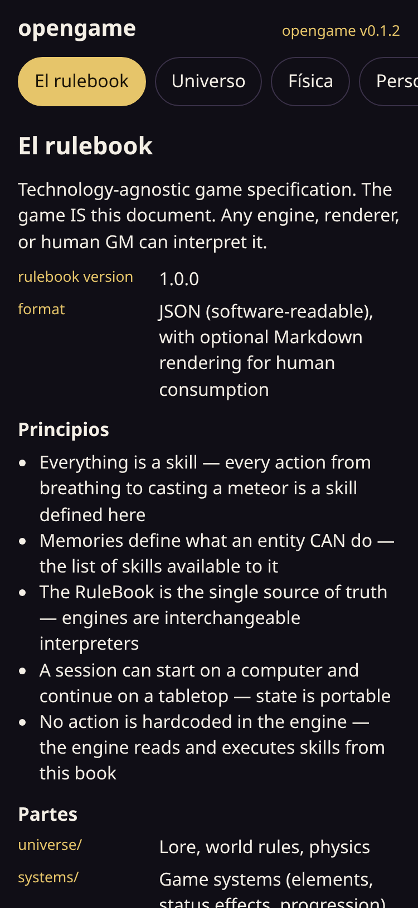

# 📖 opengame

**Browser rulebook of the Woven World: an isekai action RPG where every action is a skill.**

> El juego es este rulebook: lo abres y lees el universo, sin instalar nada.

**[▶ Ver el rulebook](https://juliangdeveloper.github.io/opengame/)**

## Cómo se usa
- Elige una parte: universo, personajes, elementos, skills, memorias, controles o la escena.
- El texto sale del JSON de `rulebook/`. El mundo es un tapiz: caminar, mirar y lanzar un hechizo son skills.
- El Guía existe entre mundos y entrega las skills. Al nacer, el personaje solo puede verlo.
- Nueve elementos, un mismo pozo de puntos y el aguante limitan lo que se puede hacer.
- La página cabe en el celular; el texto de cada parte se desplaza dentro de la pantalla.

## Stack
HTML, CSS y JavaScript vanilla, sin frameworks ni build. El rulebook vive en JSON.
Al abrirse guarda el progreso en `localStorage` (`meta.v1.opengame`), que lee el [portafolio](https://juliangdeveloper.github.io/).

## Licencia
MIT

Versión actual: `opengame v0.1.2`.
